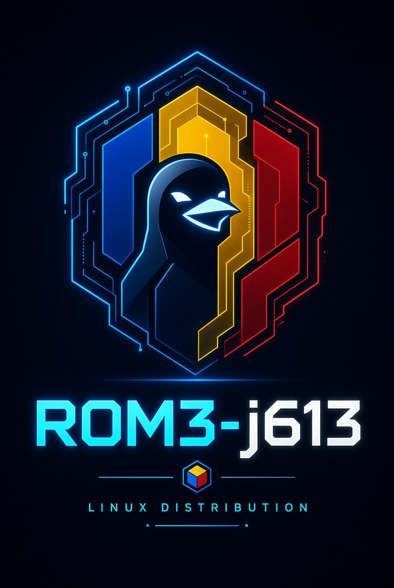

<p align="center">
  
</p>

<h1 align="center">ROM3-j613</h1>

<p align="center">
  A tested, hardware-specific Linux distribution layer for the Apple MacBook Air
  13-inch M3 (<code>apple,j613</code>).
</p>

> [!IMPORTANT]
> ROM3-j613 is currently a bring-up distribution, not a general-purpose M3
> distribution. Only `apple,j613` is tested. Other M3 Macs are not supported.

ROM3-j613 is a downstream Arch Linux ARM and Aurora Silicon integration. It
does not replace Linux, Mesa, the Aura-derived bootloader or the Arch package ecosystem. It packages
the known-good combination for one board so a system update cannot silently
replace components responsible for display, GPU or speaker-safety regressions.

## Verified state

```text
Board:           apple,j613
Hardware:        MacBook Air 13-inch M3
Distribution:    ROM3 (VARIANT_ID=j613)
Kernel:          7.3.0-1-45-ARCH
ROM3 kernel:     linux-rom3 7.3.0.aurora1-45
Bootloader:      rom3 1.0.0b17-2
U-Boot:          uboot-rom3 2026.07.aurora11-1
Display:         2560x1664 internal panel, 64-row notch exposed
GPU:             Apple M3 G15G
Render node:     /dev/dri/renderD128
OpenGL:          Apple M3 (G15G C0)
Audio:           speakersafetyd active
Stage 2 SHA-256: 2e74c732cc62a56aa6b236e9ba673780b6f77261664d9d93de878b50cc7957d9
```

The verified diagnostics, package set and recovery procedures currently live
in
[`adrgu372/aurora-m3-j613-fixes`](https://github.com/adrgu372/aurora-m3-j613-fixes).

## Why this project exists

An ordinary `pacman -Syu` can replace the bootloader, compositor, graphics
stack or audio stack with versions that have not been tested together on
`J613`. On this machine, such a partial upgrade previously caused:

- no usable internal display;
- GPU initialization failure;
- KWin without a working render device;
- speaker-safety lock and complete loss of audio.

ROM3-j613 turns the tested package combination into an explicit compatibility
contract. Sensitive packages remain in a signed ROM3 repository and ordinary
Arch updates are allowed only around that tested core.

Pacman-visible package identifiers use the ROM3 namespace. The
`rom3-j613-package-migration` package provides and replaces the legacy
Aura/Aurora identifiers in one transaction; upstream repository URLs and
source provenance are intentionally unchanged.

The installed operating system reports `NAME="ROM3"`, `ID=rom3` and
`VARIANT_ID="j613"` through `/etc/os-release`. See [identity.md](docs/identity.md).

## Architecture

```text
Arch Linux ARM rolling base
          |
Aurora Silicon hardware stack
          |
ROM3-j613 compatibility overlay
  - patched kernel
  - patched Aura-derived bootloader
  - tested Mesa/Vulkan
  - tested KWin/audio set when required
          |
ROM3 update guard and recovery tools
          |
ROM3 Installer catalog and payload
```

## Repository layout

| Path | Purpose |
|---|---|
| `stack/verified-stack.json` | Machine-readable tested package set |
| `stack/quarantine.packages` | Packages that may not drift without qualification |
| `packages/` | ROM3 package recipes and variants |
| `pacman/` | Client repository configuration example |
| `configs/` | Pacman client, mirrorlist and local service configuration |
| `repo/` | Local binary repository workspace; generated files are not committed |
| `docs/` | Architecture, update policy, support matrix and installer plan |
| `scripts/` | Live verification, stack checking and repository tooling |
| `assets/` | Project branding |

## Current milestone

The project starts with the already verified `J613` stack and a fail-closed
update policy. The tested kernel and bootloader recipes, exact-version meta-package,
update guard and initial local test packages now exist.

The signed package feed is public:

https://github.com/adrgu372/ROM3-j613/releases/tag/stable-20261127.2

The snapshot contains the complete direct dependency closure of the
meta-package. Kernel 45 carries the SIO protocol-10 tables required by the b17 bootloader,
and both the 47 bootloader audio scenarios and the live J613 audio/display checks
pass. The bootloader's external-DCP default is explicitly disabled on this board because
it crashes the primary DCP with the current 14.7 firmware. Its keyring package
repopulates and locally trusts the ROM3 signing key after Aurora creates the
machine's pacman master key.

The b14.1-to-b17 bootloader delta also exposes the full notch-aware panel geometry,
reads panel brightness metadata from the ADT, selects the matching SIO
protocol-9/10 layout from kernel 44 and hardens live-DCP, AOP, video-encoder,
PCIe and NVMe handoff. Firmware-27.2 display/GPU support is included but
inactive on the current 14.7 component firmware. External USB-C displays remain
disabled until that handoff is qualified on J613.

The source filesystem image is public:

https://github.com/adrgu372/ROM3-j613/releases/tag/image-20261123.1

It contains the filesystem archive split into GitHub-sized parts, Sigstore
provenance, signed checksums and a reassembly script.

The native installer payload assembled from that image is public:

https://github.com/adrgu372/ROM3-j613/releases/tag/image-20261123.2

It contains the native installer ZIP in six parts, `os_list` metadata, the
J613-only schema-5 catalog on the `testing` channel, signed checksums and a
payload reassembly script. The upstream Aurora installer does not trust this
catalog; a ROM3 installer build must bundle the ROM3 catalog root.

`scripts/build-rom3-installer-macos.sh` prepares that installer on macOS from
the pinned upstream revision. It produces an ad-hoc technical-preview build;
Developer ID signing, notarization and clean-install qualification remain
separate release gates.

A CI-built technical preview is available as a prerelease:

https://github.com/adrgu372/ROM3-j613/releases/tag/installer-preview-0.1.5

It targets only `apple,j613`. The package is intentionally unsigned and the
app is ad-hoc signed; do not treat it as a production installer.

See [ROADMAP.md](ROADMAP.md).

## Safety

- Do not remove packages from quarantine without cold-boot validation.
- Do not publish unsigned packages or repository databases.
- Do not replace the active Stage 2 image without a verified backup.
- Do not treat build success as hardware qualification.
- Do not add another Mac model based only on a shared SoC name.

For a working `J613` installation, [docs/bootstrap.md](docs/bootstrap.md)
attaches the signed ROM3 feed without upgrading the system.

## Updating an installed system

Use the ROM3 update guard instead of an unrestricted `pacman -Syu`:

```bash
# Preview pending changes without modifying the system.
sudo rom3-j613-update --check

# Apply the reviewed update.
sudo rom3-j613-update --apply
```

`--apply` takes a read-only Btrfs snapshot and boot backups before updating,
keeps unqualified quarantined packages blocked, and runs `rom3-j613-check`
after the transaction. A kernel update requires a reboot followed by:

```bash
sudo /usr/share/rom3-j613/verify-live-system.sh
```

Systems still on `stable-20261122.9` or `stable-20261124.2` should install
`rom3-j613-guard` and `rom3-j613-release` first, then authenticate
[`override-20261127.1`](https://github.com/adrgu372/ROM3-j613/releases/tag/override-20261127.1)
with `rom3-j613-override configure`. The release notes contain the exact signed
commands for the bootloader b17 and kernel 45 transition.

Running `pacman -Syu` directly is not the supported update path for the
protected ROM3 stack. See [docs/update-model.md](docs/update-model.md).

Upstream kernel, bootloader, audio, image-builder and installer changes are checked
daily by a GitHub Actions workflow. It updates one issue with a
`BUILD CANDIDATE`, `REVIEW` or `WAIT` recommendation without compiling
anything automatically. See [docs/upstream-watch.md](docs/upstream-watch.md).

The installed system can instead use the Qt/Plasma
[ROM3 Control Center](docs/control-center.md) for status, safe updates,
diagnostics and automatic installation of the newest signed ROM3 override from
GitHub.

Replacement kernels or other sensitive packages can be delivered through a
signed override feed hosted in any GitHub repository. See
[docs/override-feed.md](docs/override-feed.md); signature checks and
quarantine rules remain active, with only the exact manifest versions admitted.

